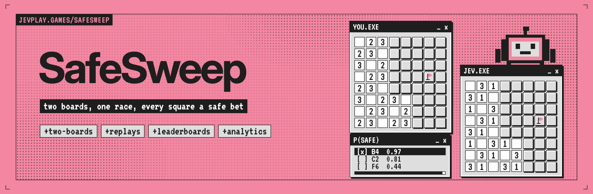
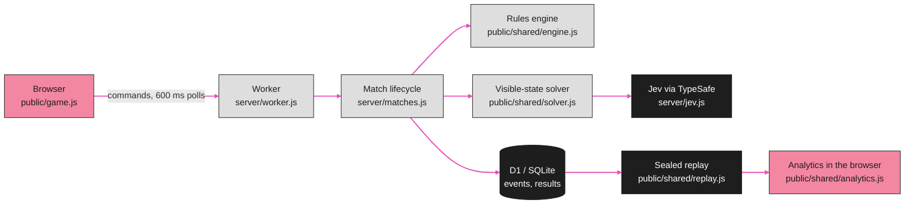
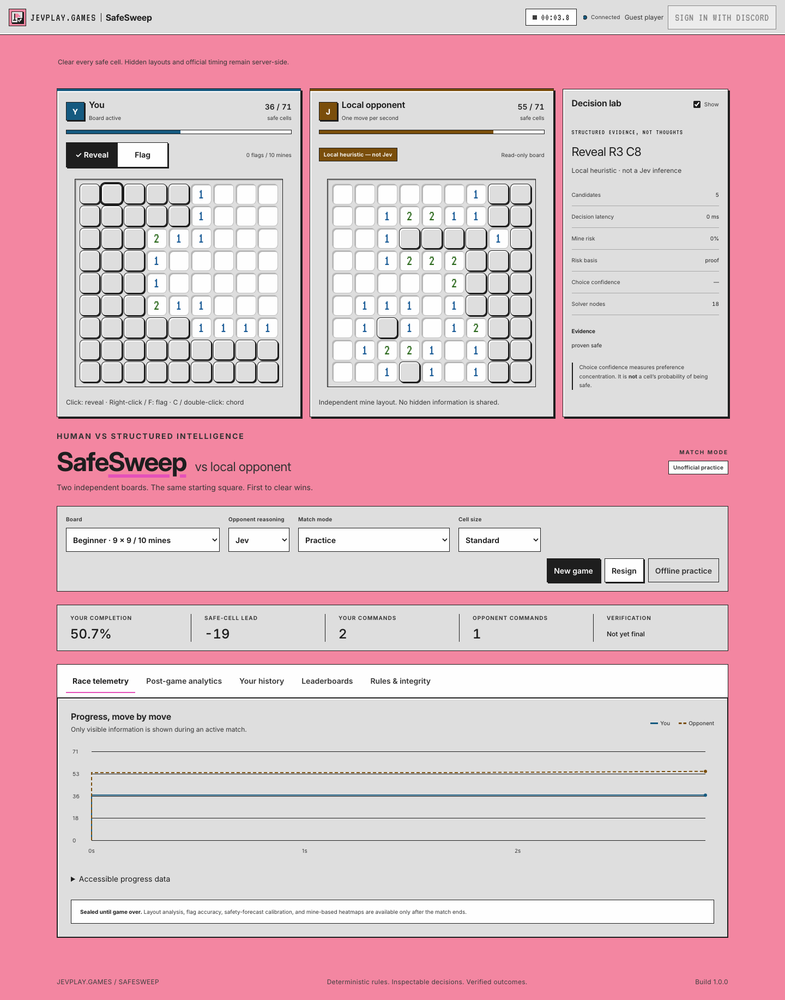

<p align="center"></p>

<div align="center">

# SafeSweep

**Race Jev across two minesweeper boards from the same opening square, where every reveal is a bet that the square is safe.**


[Quick start](#quick-start) · [How it works](#how-it-works) · [Analytics](#analytics) · [Enable Jev](#enable-jev) · [Discord and rankings](#discord-and-rankings) · [Tests, replay verification and benchmarks](#tests-replay-verification-and-benchmarks) · [Repository layout](#repository-layout) · [Contributing](#contributing)

</div>

---

SafeSweep is a server-authoritative two-board minesweeper race against Jev. Both players open the same coordinate on independently generated boards, and the first to reveal every safe cell wins. Every match produces a deterministic, hash-linked replay, a verified leaderboard entry when it qualifies, and detailed replay-derived analytics. It is part of [jevplay.games](https://jevplay.games) and was called Minesweeper before the rename.

> [!NOTE]
> **What is shipped and measured.** The game is implemented and locally tested. It is served today at the pre-rename address `minesweeper.jevplay.games`; `safesweep.jevplay.games` (Cloudflare Workers Free plan + D1) goes live at the rename cutover, after which the old address redirects to it (`docs/DEPLOYMENT.md`). Real TypeSafe credentials, Discord authorization and the Cloudflare deployment itself were not exercised in this environment. Without credentials the game plays against an explicitly labeled local solver, and those games are unofficial. The bundled benchmark contains local baselines only (zero live Jev calls). See [Operational boundaries](#operational-boundaries).

## Quick start

Use Node.js **22.16.0 or later** (built-in SQLite; Node prints an experimental warning). There are **no npm runtime dependencies and no frontend build step**.

```sh
cd jev-safesweep        # the clone directory (jev-minesweeper before the repo rename)
npm start
```

Open `http://localhost:3000`. Select **New game**, then click your starting square. The same coordinate opens on the opponent's independently generated board: Jev when `TYPESAFE_API_KEY` is set, otherwise the labeled local heuristic. `npm start` is a local development shim over the same Worker code production runs (`server/worker.js`), with SQLite standing in for D1. It tolerates a missing `.env` and creates a private SQLite database at `data/safesweep.sqlite` (an existing pre-rename `data/minesweeper.sqlite` is reused). To deploy, follow `docs/DEPLOYMENT.md` (`npm run deploy`, `npm run db:remote`).

For configuration, copy `.env.example` to `.env`, edit the relevant values, and restart. On Windows PowerShell, use `Copy-Item .env.example .env`; on macOS/Linux, use `cp .env.example .env`. [START-HERE.md](START-HERE.md) is the same in three steps.

### The game

The browser offers beginner (9×9/10), intermediate (16×16/40), and expert (30×16/99) boards. Easy, Normal, Hard, and Jev reasoning levels change deduction and enumeration budgets rather than introducing deliberate random mistakes. Both boards use the same preset but independent hidden layouts. The protected first opening, reveal, flag/unflag, zero expansion, and safe/unsafe chording are implemented.

First to reveal every safe cell wins. A single explosion does not award the other player a win: the surviving player still has to clear. Two explosions or an uncleared deadline draw. Clears in the same 100-ms interval draw. Resignation or abandonment after starting loses. Rankings use wins divided by eligible completed matches, with twenty matches needed to qualify.

The interface includes touch reveal/flag modes, keyboard navigation, standard and 44-pixel large-cell modes, visible focus, reduced-motion support, readable status, accessible data tables, a replay slider, and an explicitly selected local offline-practice mode for an already loaded page. It does not promise a cold offline load or local Jev inference.

## How it works



<p align="center"></p>

The server holds the seeds, mine layouts, official time and outcomes. Opponent moves, 100-ms adjudication and abandonment are applied lazily by whichever request next touches the match, so nothing runs in the background (`docs/ARCHITECTURE.md`). When a match ends, its event journal is sealed into a replay that anyone can re-verify against the same engine.

## Analytics

| Area | Examples |
|---|---|
| Action-level performance | Reveal/flag/unflag/chord counts, safe-cell yield, flood expansion, per-command timing, idle gaps, command rate, first/last action |
| Decision quality | Proven-safe versus unresolved reveals, known-mine selections, available safe alternatives, exact-risk coverage, known-alternative regret, constraint/frontier complexity |
| Flags and board structure | Post-game precision/recall/F1, incorrect flags, churn, zero regions, opening-size distribution, adjacency histogram, static 3BV, edge/corner mines |
| Race dynamics | Progress timeline, time ahead/tied, lead changes, largest leads, integrated lead area, clear-only timing |
| Jev behavior | Candidate and legal-action counts, evidence, selected action, risk source, selection confidence, solver nodes/cutoffs, latency distributions, HTTP attempts/retries, errors and fallbacks |
| Probability calibration | Selected and all-evaluated safety forecasts, Brier score, log loss, ten reliability bins, expected calibration error, sample counts |
| Operations and integrity | Rejected requests, idempotent retries, reconnects, scheduling misses, verification state, rank eligibility and reasons |
| History and rankings | W/L/D, clear-win rate, Wilson intervals, actual clear times, streaks, size/difficulty/period/mode filters, Channel/Server/World views |
| Export | Analytics JSON, action CSV, timeline CSV (derived in your browser from the verified replay), event JSONL, replay JSON, history CSV, own-profile JSON (files are named `safesweep-…`) |

**Truth-derived data is sealed until the match is over.** No active mine bitmap, unrevealed adjacency, correct-flag signal, or hindsight evaluation is sent to the player or opponent. Undefined ratios and missing usage produce `null`, not fabricated zeros. A full metric dictionary and a generated field catalog are included.

Read [ANALYTICS.md](docs/ANALYTICS.md) before interpreting probabilities, speed, 3BV, or estimated cost. An unresolved move is not proof that guessing was unavoidable. Choice confidence is not cell safety. Recorded commands are not physical mouse clicks. Provider usage is not a billing guarantee.

## Enable Jev

Set `TYPESAFE_API_KEY` in `.env`, keep or deliberately change the pinned `JEV_MODEL`, and restart. The server sends bounded visible-state questions directly to TypeSafe; the key never reaches the browser. The adapter validates typed Choice/Noul/Score answers and selected legal actions.

A forced single candidate is a deterministic deduction, not a remote request. Missing credentials, service failures, and local fallbacks are labeled. Ranked service delays beyond the allowed tolerance or fallback use permanently disqualify the match. Difficulty labels describe configured reasoning budgets; they are not measured claims about real Jev strength.

## Discord and rankings

Set the three Discord application values in `.env`. Configure the exact callback `APP_ORIGIN/api/auth/discord/callback` and interaction endpoint `APP_ORIGIN/api/discord/interactions`. Use the commands-only guild installation and register the launch command:

```sh
npm run discord:register
```

Run `/jev play` in a guild text channel, follow its private expiring launch link, and sign in with that same Discord account. OAuth establishes the user; a verified signed interaction establishes channel/server context. Raw URL guild IDs are never accepted. The game also runs as a Discord Activity ([ACTIVITY.md](docs/ACTIVITY.md)). See [DEPLOYMENT.md](docs/DEPLOYMENT.md) for the setup sequence, the rename cutover and limitations.

## Tests, replay verification and benchmarks

```sh
npm test
npm run test:coverage
npm run verify -- reports/sample/replay.json
npm run bench -- --boards 100
```

`tests/rename.test.js` pins the rename's compatibility promises: a replay sealed before the rename (format `jev-arcade-replay`) still verifies, pre-rename leaderboard rows rank on the same board, and one deployment serves both `safesweep.jevplay.games` and the pre-rename `minesweeper.jevplay.games`.

The included benchmark ran **100 matched boards across five local policies: 500 games**. It made **zero live Jev calls**. Raw game records, action traces, clear-rate intervals, and paired/swapped independent-board race results are in `reports/benchmark/`.

A separately requested live benchmark is supported and can incur provider charges:

```sh
npm run bench -- --boards 100 --remote --difficulty jev --out reports/live-jev
```

No missing-key substitution is allowed for `--remote`; failures in an authorized live run remain counted in its results. Do not present the bundled local baseline as Jev performance.

The optional browser test (`tests/browser_smoke.py`) uses Python Playwright, a development-only tool, not an application dependency. The recorded run in `reports/browser/` navigates a real Chromium against the local Worker shim; the original 1.0.0 recording had to use a documented DOM/API bridge because that runner's Chromium policy blocked navigation. Native Node HTTP/SSE, ownership, CSRF, and server headers are also tested separately. See [TESTING.md](docs/TESTING.md).

## Repository layout

```text
public/                  Single-page interface (index.html, game.css, game.js), offline practice, Activity client
  brand/                 Shared jevplay.games brand files (brand.css, brand.js, fonts, OFL licences, icons)
  art/                   SafeSweep SVG art (flag, mine, burst)
  shared/                Pure code shared by browser and Worker: engine, solver, decisions, replay, analytics
server/                  Worker entry and routing, match lifecycle, Jev adapter, Discord, security, config
  main.js, local-db.js   Local development shim (Node http, SQLite behind the D1 interface)
migrations/              D1 schema (applied by wrangler and by the local shim)
scripts/                 Replay verification, Discord command registration, backup, manifest, sample report
bench/                   Matched-seed policy benchmark and CPU measurements
tests/                   Node tests, fixtures (including a pre-rename replay) and the Playwright smoke test
docs/                    Architecture, analytics, API, security, deployment, Activity, testing, sources
reports/                 Executed test output, benchmarks, screenshots, synthetic sample exports
assets/                  README banner and GitHub social preview; assets/src holds their HTML sources and render.mjs
wrangler.jsonc           Cloudflare Worker, routes, D1 binding and vars
```

## Operational boundaries

This runs inside the Cloudflare Workers Free plan (10 ms CPU per request, 100 k requests/day, D1 write allowance) with durable daily caps; it is not a horizontally distributed tournament platform. CPU figures in `reports/cpu/` are from Node, not workerd. See `docs/DEPLOYMENT.md`.

Hidden-information and replay controls prevent straightforward score/state forgery. They do not prove that the human used no external assistance, prevent a trusted host operator from altering its own data, or constitute an independent security/accessibility certification. Real-provider smoke testing and a production load/security review remain deployment gates.

No external fonts, artwork, proprietary SDKs, credentials, runtime database, or third-party source bundles are fetched at runtime; the Inter and VT323 fonts are self-hosted under the SIL Open Font License (`public/brand/OFL.txt`, `public/brand/OFL-VT323.txt`), and third-party notices are in [THIRD_PARTY_NOTICES.md](THIRD_PARTY_NOTICES.md).

## Contributing

Issues and pull requests are welcome. Run `npm test` before opening a pull request, keep `public/shared/` free of DOM and I/O, and do not change stored identifiers (replay format `jev-arcade-replay`, engine/generator/policy versions, `matches.game_id`) without a version bump: replays and results recorded before the SafeSweep rename must keep verifying and ranking. Licensed under the [MIT License](LICENSE).

<p align="center">
<sub>A jevplay.games game · Steward: CompleteTech LLC · MIT licensed<br>
Not an official TypeSafe AI publication; the pink, ink and pixel-window styling is a nod to <a href="https://typesafe.ai">typesafe.ai</a>. Jev, System One and TypeSafe are their respective owners' names.</sub>
</p>
